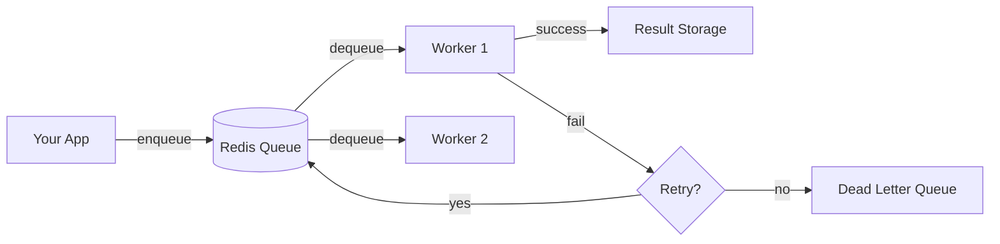

# 🚀 Distributed Task Queue

[](https://www.python.org/downloads/)
[](https://redis.io/)
[](https://docker.com/)
[](LICENSE)
[](tests/)

A lightweight, production-ready distributed task queue built with Python and Redis. Execute background jobs across multiple worker nodes with automatic retries, priority scheduling, and real-time monitoring.

<p align="center">
  
</p>

---

## ✨ Features

| Feature | Description |
|---------|-------------|
| 🔄 **Distributed Processing** | Run tasks across multiple worker nodes in parallel |
| ⚡ **Priority Queue** | High-priority tasks are processed first |
| ⏰ **Delayed Tasks** | Schedule tasks to run in the future |
| 🔁 **Auto Retry** | Failed tasks retry with exponential backoff |
| ⏱️ **Task Timeouts** | Kill hung tasks automatically |
| 💓 **Worker Heartbeats** | Detect and handle dead workers |
| 📊 **Result Storage** | Store and retrieve task execution results |
| 📝 **Structured Logging** | Production-grade logging (text/JSON) |
| 🔌 **Connection Pooling** | Efficient Redis connection management |
| 💀 **Dead Letter Queue** | Failed tasks preserved for debugging |
| 🖥️ **CLI Tool** | Command-line interface for queue management |
| 📈 **Web Dashboard** | Real-time monitoring UI |
| 🐳 **Docker Ready** | One-command deployment with docker-compose |
| 📦 **Batch Operations** | Enqueue multiple tasks efficiently |

---

## 🏗️ Architecture

```
┌─────────────────────────────────────────────────────────────────────────┐
│                           DISTRIBUTED TASK QUEUE                         │
├─────────────────────────────────────────────────────────────────────────┤
│                                                                          │
│   ┌──────────────┐         ┌──────────────┐         ┌──────────────┐   │
│   │              │         │              │         │              │   │
│   │  Your App    │────────▶│    Redis     │◀────────│  Worker 1    │   │
│   │  (Producer)  │         │   (Broker)   │         │  (Consumer)  │   │
│   │              │         │              │         │              │   │
│   └──────────────┘         └──────┬───────┘         └──────────────┘   │
│                                   │                                     │
│                                   │                 ┌──────────────┐   │
│                                   │                 │              │   │
│                                   └────────────────▶│  Worker 2    │   │
│                                                     │  (Consumer)  │   │
│                                                     │              │   │
│                                                     └──────────────┘   │
│                                                                          │
├─────────────────────────────────────────────────────────────────────────┤
│  QUEUES: [Priority Queue] [Scheduled Queue] [Processing] [Dead Letter]  │
└─────────────────────────────────────────────────────────────────────────┘
```

### Data Flow



---

## 📁 Project Structure

```
distributed-task-queue/
│
├── 🔧 Core Components
│   ├── config.py              # Configuration settings
│   ├── redis_client.py        # Redis connection management
│   ├── logger.py              # Logging configuration
│   ├── task_queue.py          # Core queue implementation
│   ├── worker.py              # Worker node implementation
│   └── tasks.py               # Task definitions
│
├── 🖥️ Interfaces
│   ├── cli.py                 # Command-line interface
│   ├── dashboard.py           # Web monitoring dashboard
│   ├── run_worker.py          # Worker startup script
│   └── enqueue_tasks.py       # Sample task producer
│
├── 🐳 Docker
│   ├── Dockerfile             # Worker container image
│   └── docker-compose.yml     # Full stack deployment
│
├── 🧪 Tests
│   └── tests/
│       ├── test_task_queue.py
│       └── test_worker.py
│
└── 📄 Config Files
    ├── requirements.txt       # Dependencies
    ├── .env.example           # Environment template
    └── EXPLANATION.md         # Detailed documentation
```

---

## 🚀 Quick Start

### Prerequisites

- Python 3.8+
- Redis Server 6.0+

### Installation

```bash
# Clone the repository
git clone https://github.com/yourusername/distributed-task-queue.git
cd distributed-task-queue

# Create virtual environment
python -m venv venv
source venv/bin/activate  # On Windows: venv\Scripts\activate

# Install dependencies
pip install -r requirements.txt

# Configure environment
cp .env.example .env
```

### Running (Option 1: Manual)

**1. Start Redis** (if not already running):
```bash
redis-server
```

**2. Start Worker(s):**
```bash
# Terminal 1
python run_worker.py worker-1

# Terminal 2 (optional - for parallel processing)
python run_worker.py worker-2
```

**3. Enqueue Tasks:**
```bash
# Terminal 3
python enqueue_tasks.py
```

### Running (Option 2: Docker) 🐳

```bash
# Start everything with one command
docker-compose up -d

# View logs
docker-compose logs -f

# Scale workers
docker-compose up -d --scale worker-1=3

# Stop everything
docker-compose down
```

### Web Dashboard 📈

```bash
python dashboard.py
# Open http://localhost:5000
```

<p align="center">
  <em>Real-time monitoring of queue status, workers, and task statistics</em>
</p>

---

## 💻 Usage

### Enqueuing Tasks

```python
from task_queue import TaskQueue

queue = TaskQueue()

# Simple task
task_id = queue.enqueue("send_email", {
    "to": "user@example.com",
    "subject": "Hello!",
    "body": "Welcome to our platform."
})

# High priority task (processed first)
queue.enqueue("urgent_alert", {"message": "Server down!"}, priority=10)

# Delayed task (execute in 1 hour)
queue.enqueue("send_reminder", {"user_id": 123}, delay_seconds=3600)

# Batch enqueue (efficient for multiple tasks)
task_ids = queue.enqueue_batch([
    {"task_name": "send_email", "payload": {"to": "user1@test.com"}},
    {"task_name": "send_email", "payload": {"to": "user2@test.com"}},
    {"task_name": "process_image", "payload": {"url": "img.jpg"}, "priority": 5},
])

# Check task status
status = queue.get_task_status(task_id)
print(f"Task status: {status}")  # pending, processing, completed, failed

# Get task result
result = queue.get_result(task_id)
print(f"Result: {result}")

# Cancel a pending task
queue.cancel_task(task_id)

# Retry a failed task
queue.retry_failed_task(task_id)
```

### CLI Commands

```bash
# Check queue status
python cli.py status

# List active workers
python cli.py workers

# Enqueue a task from command line
python cli.py enqueue send_email '{"to": "user@example.com"}' --priority 5

# Get task info
python cli.py info <task-id>

# List pending tasks
python cli.py list pending --limit 20

# Cancel a task
python cli.py cancel <task-id>

# Retry failed task
python cli.py retry <task-id>

# Clear dead letter queue
python cli.py clear-dead
```

### Defining Tasks

```python
# tasks.py
from worker import task

@task("send_email")
def send_email_task(payload):
    recipient = payload["to"]
    subject = payload["subject"]
    
    # Your email sending logic here
    send_email(recipient, subject, payload["body"])
    
    return {"status": "sent", "recipient": recipient}

@task("process_image")
def process_image_task(payload):
    image_url = payload["url"]
    
    # Your image processing logic here
    processed = resize_image(image_url)
    
    return {"status": "processed", "url": processed}
```

### Creating a Worker

```python
from worker import Worker
from tasks import ALL_TASKS

worker = Worker(worker_id="my-worker")

# Register task handlers
for task_name, handler in ALL_TASKS:
    worker.register_task(task_name, handler)

# Start processing
worker.run()
```

---

## ⚙️ Configuration

All settings are in `config.py` and can be overridden via environment variables:

| Variable | Default | Description |
|----------|---------|-------------|
| `REDIS_HOST` | `localhost` | Redis server hostname |
| `REDIS_PORT` | `6379` | Redis server port |
| `REDIS_PASSWORD` | `None` | Redis authentication password |
| `REDIS_DB` | `0` | Redis database number |
| `MAX_RETRIES` | `3` | Max retry attempts before dead letter |
| `RETRY_DELAY_BASE` | `2` | Base delay for exponential backoff (seconds) |
| `TASK_TIMEOUT` | `300` | Max execution time per task (seconds) |
| `HEARTBEAT_INTERVAL` | `10` | Worker heartbeat frequency (seconds) |
| `WORKER_POLL_INTERVAL` | `1` | Queue polling interval (seconds) |
| `LOG_LEVEL` | `INFO` | Logging level (DEBUG/INFO/WARNING/ERROR) |
| `LOG_FORMAT` | `text` | Log format (`text` or `json`) |
| `RESULT_TTL` | `86400` | Result storage duration (seconds) |

---

## 🔄 Retry Mechanism

Failed tasks automatically retry with **exponential backoff**:

```
Attempt 1: Execute immediately
    ↓ (fails)
Attempt 2: Wait 2 seconds, retry
    ↓ (fails)
Attempt 3: Wait 4 seconds, retry
    ↓ (fails)
Attempt 4: Wait 8 seconds, retry
    ↓ (fails)
→ Move to Dead Letter Queue
```

### Why Exponential Backoff?

If a task fails because an external service is down, retrying immediately won't help. Increasing delays give the service time to recover while preventing system overload.

---

## 📊 Queue Types

| Queue | Purpose |
|-------|---------|
| **Task Queue** | Main queue for pending tasks (sorted by priority) |
| **Scheduled Queue** | Tasks waiting for their execution time |
| **Processing Queue** | Tasks currently being executed |
| **Dead Letter Queue** | Failed tasks that exceeded retry limit |

---

## 🧪 Testing

```bash
# Run all tests
pytest tests/ -v

# Run with coverage
pytest tests/ --cov=. --cov-report=html

# Run specific test file
pytest tests/test_task_queue.py -v
```

---

## 📈 Monitoring

### Check Queue Statistics

```python
from task_queue import TaskQueue

queue = TaskQueue()
stats = queue.get_queue_stats()

print(f"Pending tasks: {stats['pending']}")
print(f"Scheduled tasks: {stats['scheduled']}")
print(f"Processing: {stats['processing']}")
print(f"Dead letter: {stats['dead_letter']}")
```

### Worker Heartbeats

Workers send heartbeats every 10 seconds. Check active workers:

```python
import redis
client = redis.Redis()
heartbeats = client.hgetall("worker_heartbeats")
print(f"Active workers: {list(heartbeats.keys())}")
```

---

## 🔧 Production Checklist

- [ ] Set strong `REDIS_PASSWORD`
- [ ] Configure appropriate `TASK_TIMEOUT`
- [ ] Set `LOG_FORMAT=json` for log aggregation
- [ ] Monitor dead letter queue
- [ ] Set up Redis persistence (AOF/RDB)
- [ ] Run multiple workers for redundancy
- [ ] Set up alerts for worker heartbeat failures

---

## 🤝 Contributing

Contributions are welcome! Please feel free to submit a Pull Request.

1. Fork the repository
2. Create your feature branch (`git checkout -b feature/AmazingFeature`)
3. Commit your changes (`git commit -m 'Add some AmazingFeature'`)
4. Push to the branch (`git push origin feature/AmazingFeature`)
5. Open a Pull Request

---

## 📄 License

This project is licensed under the MIT License - see the [LICENSE](LICENSE) file for details.

---

## 🙏 Acknowledgments

- Inspired by [Celery](https://docs.celeryq.dev/) and [RQ](https://python-rq.org/)
- Built with [Redis](https://redis.io/)

---

## 📚 What I Learned Building This

This project helped me understand:

- **Distributed Systems**: How to design systems that work across multiple machines
- **Message Queues**: The producer-consumer pattern and why it's useful
- **Redis Data Structures**: Using sorted sets, hashes, and lists for different purposes
- **Fault Tolerance**: Implementing retries, timeouts, and dead letter queues
- **Concurrency**: Python threading, signals, and process management
- **DevOps**: Docker containerization and service orchestration

---

<p align="center">
  Made with ❤️ while learning distributed systems
</p>

<p align="center">
  ⭐ Star this repo if you found it helpful!
</p>

<p align="center">
  <a href="#-distributed-task-queue">Back to Top ⬆️</a>
</p>
